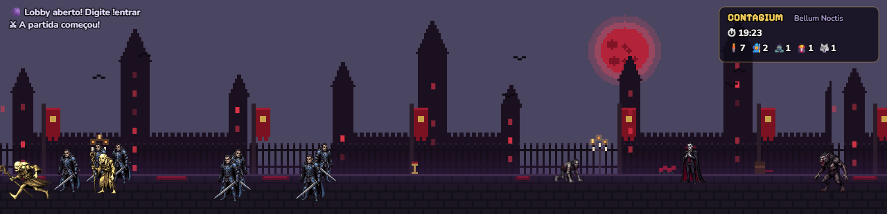
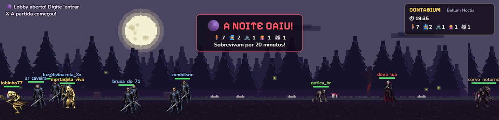
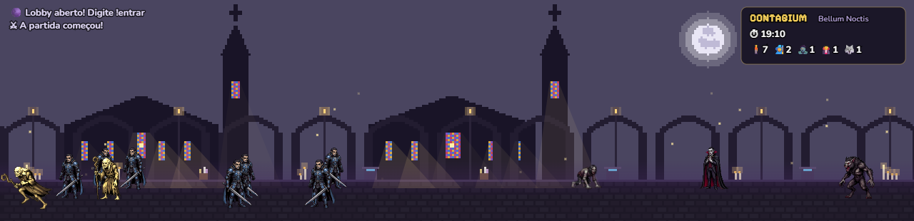
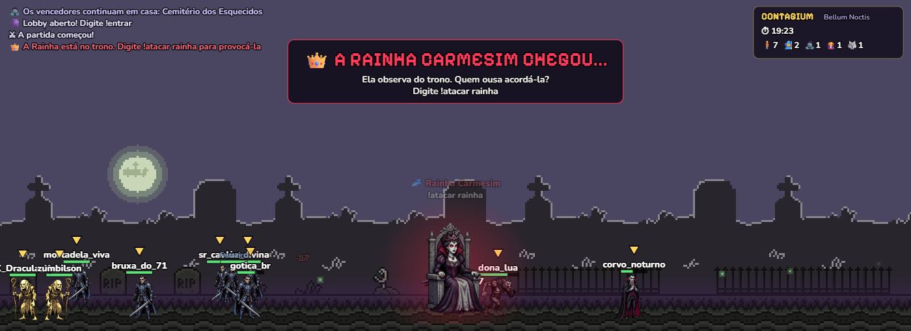
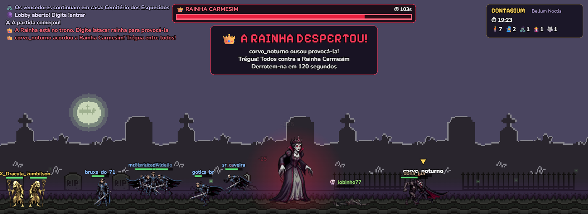

# 🩸 Contagium: Bellum Noctis

**Um jogo de infecção para o chat da Twitch, que roda como overlay no OBS.**
*A Twitch chat infection game that runs as an OBS overlay. Viewers join from chat and fight automatically as humans, wizards, zombies, vampires or werewolves.*



Cada viewer que digita `!entrar` vira um bonequinho. A maioria começa como **humano**, alguns como **bruxos**, e uma parte como **zumbis, vampiros ou lobisomens**. Os monstros contaminam os humanos, os bruxos curam e purificam, e a batalha acontece sozinha na faixa de baixo da live. Quem quiser escolhe alvos pelo chat (`!bater @fulano`). No fim, vencem os humanos que sobreviveram, ou a raça de monstro que mais contaminou.

---

## ✨ Destaques

- **Sem servidor:** é um único arquivo HTML aberto como Fonte de Navegador no OBS. Ele lê o chat da Twitch direto pelo IRC via WebSocket, de forma anônima, sem login nem backend.
- **5 classes com mecânicas próprias:**
  - 🧟 **Mordida rápida** e infecção do "Paciente Zero";
  - 🧛 **Roubo de vida** e Marca de Sangue;
  - 🐺 o **tanque**;
  - 🧙 **cura e purificação**.
- **Eventos dramáticos:**
  - ⚔ **último humano** com a Luz Sagrada;
  - 🩸 **último monstro** em Fúria;
  - ☀ **Amanhecer** enfraquecendo os monstros;
  - 👑 a **Rainha Carmesim**, uma chefe acordada pelo chat.
- **Balanceamento com simulação:** um simulador em Node.js roda centenas de partidas usando o mesmo código do jogo, para ajustar os números com dados em vez de achismo (veja abaixo).
- **Cenários em pixel art gerados por código:** floresta, castelo e catedral são desenhados proceduralmente, em camadas com parallax. Entre as partidas, o grupo **viaja** para o cenário da raça vencedora.
- **Pensado para lives pequenas e grandes:** NPCs completam partidas com pouca gente, os bonecos ficam em formação com nomes legíveis, e a lógica independe do tamanho da tela.
- **Tudo configurável** num único `config.js`, comentado em português.

| | |
|---|---|
|  |  |
|  |  |

---

## 🚀 Como rodar

1. Baixe este repositório.
2. Coloque a arte nos lugares certos. Ela **não vem no repositório**: veja [assets/COMO-OBTER.md](assets/COMO-OBTER.md).
3. Para testar, abra **`teste.html`** no navegador. O modo teste tem bots, botões de controle e estatísticas.
4. Para a live, coloque o nome do canal em `config.js` e adicione **`contagium.html`** no OBS como **Fonte de Navegador → Arquivo local** (1920 × 300).

O guia completo do streamer (comandos, regras e ajustes) está em **[LEIA-ME.md](LEIA-ME.md)**.

### Comandos principais
- **Moderadores:** `!abrir`, `!iniciar`, `!pausar`, `!encerrar`, `!tempo 20`, `!rainha`, `!cenario`.
- **Viewers:** `!entrar`, `!bater @nome`, `!curar @nome`, `!purificar @nome`, `!atacar rainha`, `!status`, `!loja`.

---

## 🧪 Simulador de equilíbrio

```bash
node ferramentas/simular.js 20 20 30    # 20 viewers, partidas de 20 min, 30 partidas
```

```
30 partidas · 20 viewers · 20 min · duração média 10.4 min

  ☀ Luz  30%   🧟 Zumbi  17%   🧛 Vampiro  27%   🐺 Lobisomem  27%
```

Dá para testar outros números sem mexer no jogo, por exemplo `OV='{"classes":{"zumbi":{"contaminaAbaixo":10}}}'`. Também dá para simular o chat mandando comandos (`CMDS=2.5`) e o evento da Rainha (`RAINHA=150`).

Alguns problemas que o simulador ajudou a encontrar e corrigir durante o desenvolvimento:
- os humanos venciam **100%** das partidas quando o chat usava comandos, porque os monstros "mergulhavam" no meio da formação humana;
- o equilíbrio mudava com a **largura da tela**, o que levou a um campo lógico fixo de 1920;
- na velocidade de teste 20x, as animações curtas do zumbi davam vantagem a ele;
- o zumbi sozinho quase nunca contaminava, o que deu origem à mecânica do "Paciente Zero".

---

## 🗂 Estrutura

| Arquivo | O que tem |
|---|---|
| `contagium.html` | A página do overlay |
| `config.js` | Todos os números do jogo, comentados |
| `jogo.js` | Regras, IA dos bonecos, eventos, desenho, chat da Twitch e modo teste |
| `cenarios.js` | Cenários procedurais em camadas e a viagem entre eles |
| `ferramentas/simular.js` | Simulador de partidas (Node.js) |
| `ferramentas/gerar-humano.ps1` | Recolore a folha do Espadachim para virar o humano |

**Tecnologias:** JavaScript puro, Canvas 2D, WebSocket (IRC da Twitch), localStorage e Node.js (simulador).

---

## 👩‍💻 Autoras
- **[larissadefarias](https://github.com/larissadefarias)**
- **Amanda Nunes** (coautora)

## 🎨 Créditos

- **Personagens:** *Gothic Vampire Undead Horde – 7 Pixel Art Character Sprite Pack* (itch.io). O autor informa que a arte foi gerada com IA e retocada à mão.
- **Cemitério:** *2D 16px Graveyard Tileset*, por segart (itch.io).
- **Fontes:** Pixelify Sans e Nunito (Google Fonts).

## 📄 Licença
O **código** está sob a [PolyForm Noncommercial 1.0.0](LICENSE): **pode estudar, modificar e usar para fins não comerciais**, mas **não pode vender nem lucrar** com o código sem autorização das autoras. A **arte** pertence aos autores dos pacotes, segue as licenças deles e não está incluída.
